# Travel Agency Booking App ✈ — Version 3

The project has three parts:

| Part | URL | For whom? |
|---|---|---|
| **Customer app** (`mobile/`) | Expo Go on the phone | Customers — in Arabic, French and English |
| **Agency dashboard** | `http://localhost:4000/admin` | Agency staff |
| **Owner dashboard** | `http://localhost:4000/owner` | **You only** — your earnings and commission |

The server (`server/`) runs both dashboards and the app API.

## Screenshots

### Customer app

| Sign in | Home (FR) | Home (AR) |
|:---:|:---:|:---:|
| 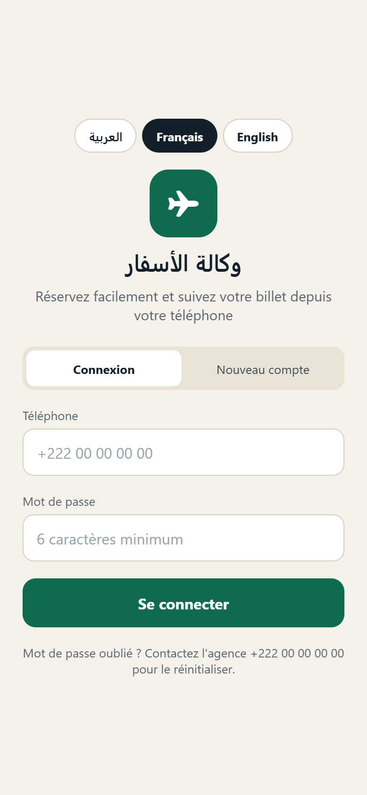 | 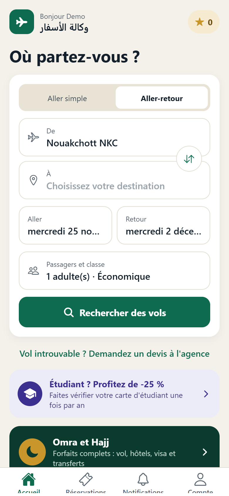 | 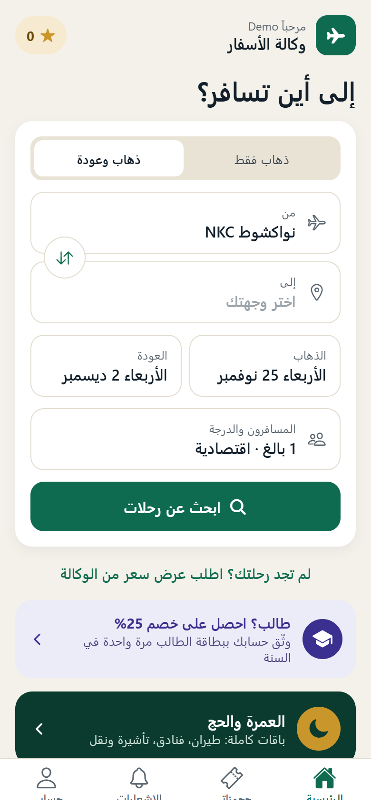 |
| **Umrah & Hajj** | **My bookings** | **My account** |
| 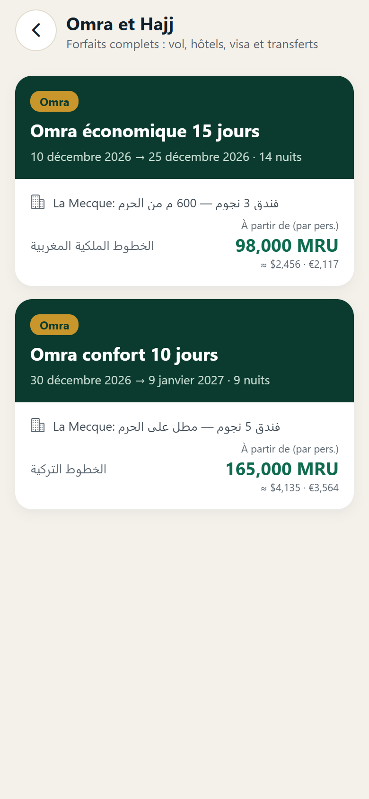 | 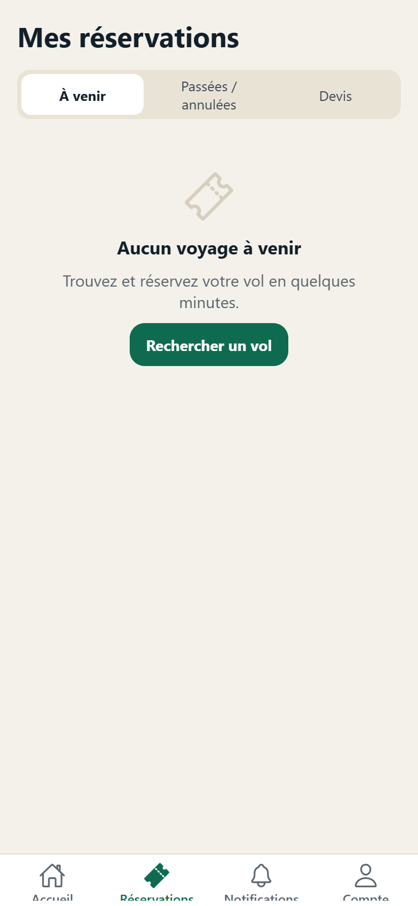 | 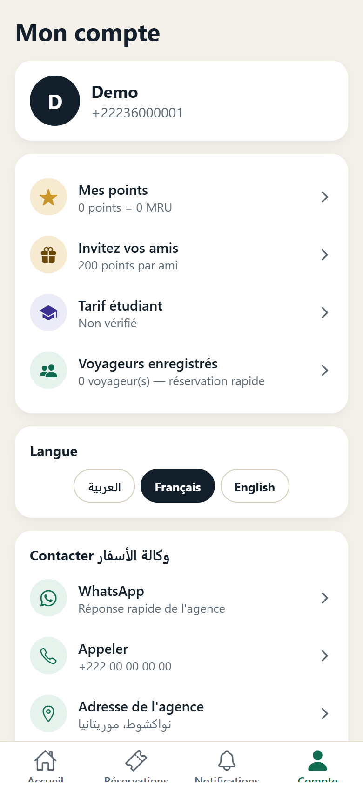 |

### Agency dashboard (`/admin`)

| Home | Bookings |
|:---:|:---:|
| 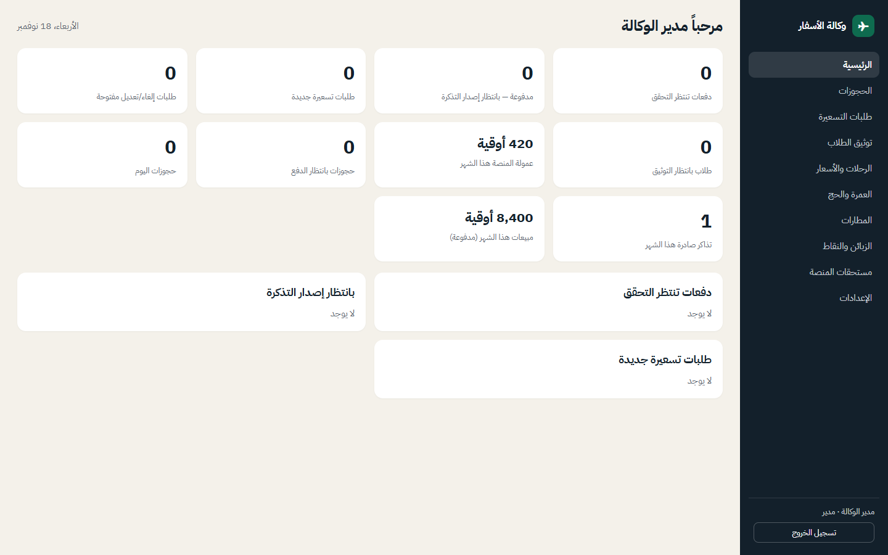 | 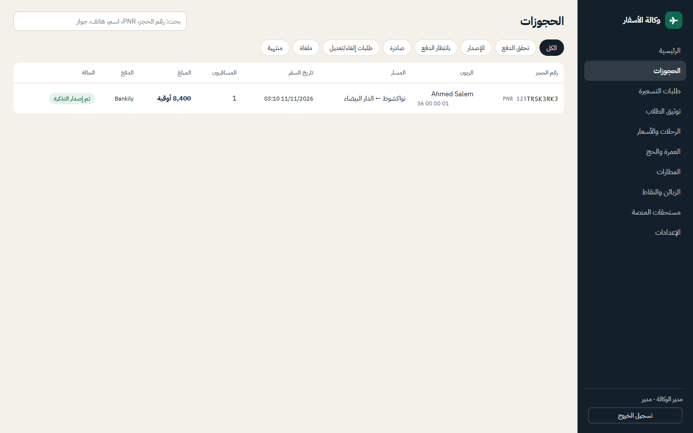 |
| **Flights & fares** | **Umrah & Hajj** |
| 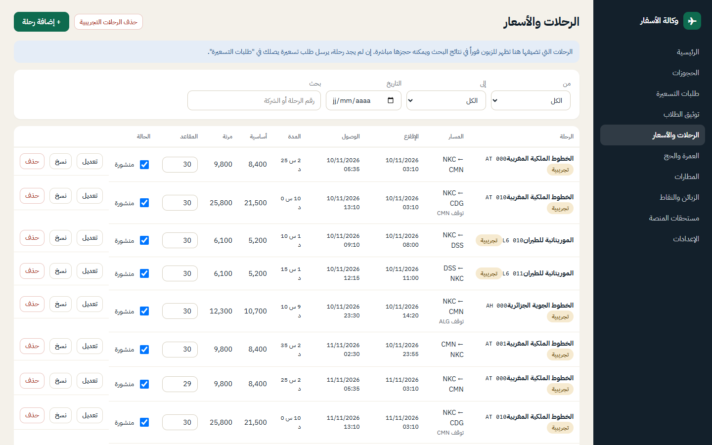 | 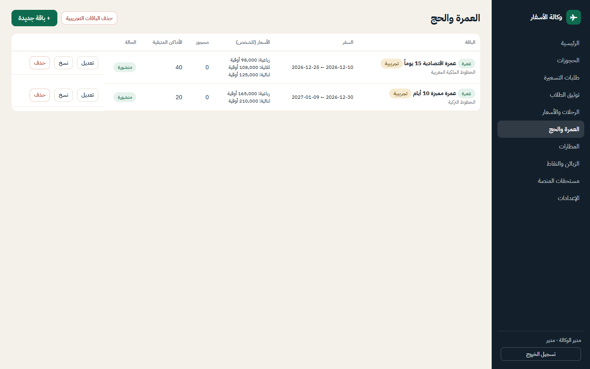 |

### Owner dashboard (`/owner`)

| Summary | Commission per booking |
|:---:|:---:|
| 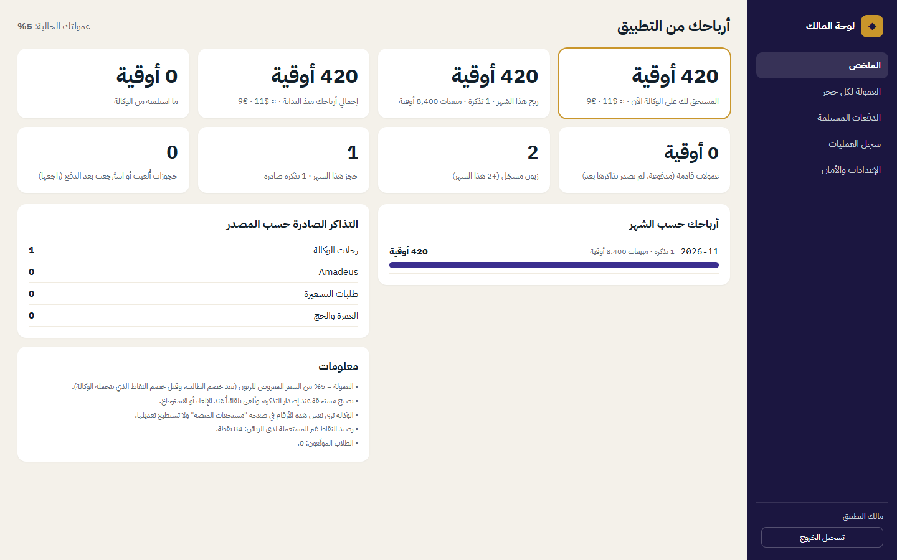 | 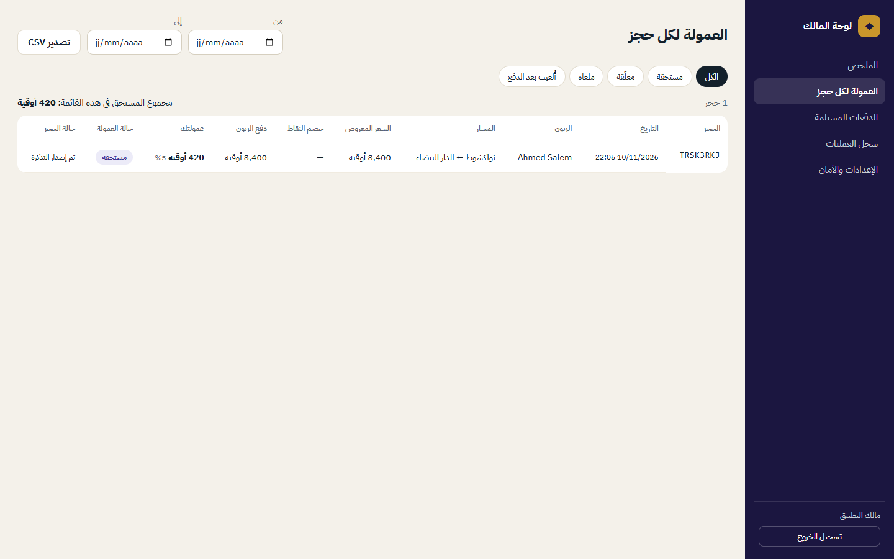 |

> The data shown in the screenshots is demo data. The dashboards' interface is in Arabic.

---

## 1) Requirements (one time)

1. **Node.js** 20 or later: https://nodejs.org
2. **VS Code**: https://code.visualstudio.com
3. The **Expo Go** app on your phone (Google Play / App Store)
4. Phone and computer on the **same Wi-Fi network**

## 2) Running from VS Code

Open the project folder, then Terminal → New Terminal.

**Terminal 1 — the server:**
```bash
cd server
npm install
npm start
```

**Terminal 2 — the app** (use + to open a new terminal):
```bash
cd mobile
npm install
npx expo start
```
Scan the QR code with Expo Go (Android) or with the camera (iPhone). To try it in the browser, press **w**.

> Upgrading from version 1: copy the old `server/data` folder into the new project before starting; the data is migrated automatically without losing anything.

### First sign-in

| Dashboard | Username | Password |
|---|---|---|
| Agency | `admin` | `admin123` → **change it immediately** |
| Owner (you) | `owner` | Generated randomly on first start and written to **`server/data/OWNER-PASSWORD.txt`** |

After signing in to the owner dashboard: change the password, **enable two-factor authentication** (Google Authenticator), then delete `OWNER-PASSWORD.txt`.

### If the phone shows "Cannot reach the server"
1. Make sure the server is running and both devices are on the same Wi-Fi.
2. Windows: allow Node.js through the firewall (Allow access).
3. Set your computer's address manually in `mobile/src/config.js`: `const MANUAL_API_URL = 'http://192.168.1.10:4000';`
   - Alternatively, start Expo with `EXPO_PUBLIC_API_URL=http://<address>:<port> npx expo start`.
   - Over USB on Android you can skip Wi-Fi entirely: `adb reverse tcp:4000 tcp:4000` and `adb reverse tcp:8081 tcp:8081`, then `npx expo start --localhost`.

---

## 3) Your 5% commission and the owner dashboard

**How it is calculated:**
- Commission = **5% of the price shown to the customer** on every booking made through the app (flights, Amadeus, quotes, Umrah & Hajj).
- Price shown = after the student discount and **before** the points discount (the points discount is paid by the agency and does not reduce your commission).
- The commission becomes **due** when the ticket is issued, and is **cancelled** automatically if the booking is cancelled or refunded.
- Changing the rate only applies to new bookings.

**In your dashboard (`/owner`):**
- Amount currently due to you, this month's earnings, all-time total, and earnings per month.
- Commission per booking, with date filters and CSV export (opens in Excel).
- **Payments received:** record every amount you receive from the agency; it is deducted from the amount due.
- **Audit log:** every important change (booking statuses, prices, settings, student verification…) with who did it and when.
- **Alert:** bookings cancelled or refunded **after payment** are highlighted for you to review. The agency must give a reason and cannot delete any booking.

**In the agency dashboard → "Platform dues":** agency staff see the same figures (your commission per booking, amount due, amount paid) **read-only**; they cannot change them or access your dashboard.

### How the agency pays you
1. **You:** Owner dashboard → Settings & security → **Your payout accounts** (Bankily / Masrvi / Sedad / bank account: number and holder name).
2. **Agency:** their dashboard → **Platform dues** → they see the amount due and your accounts, transfer the money, then fill in the **"Pay platform dues"** form: account used, amount, transaction number, receipt photo.
3. **You:** a notification appears in your dashboard → **Payments received** → open the receipt and check your account → **Confirm receipt** (you can correct the amount if a different amount arrived) or **Not received** with a reason.
4. On confirmation the amount is deducted from what is due immediately and is visible to both sides. On rejection the agency sees the reason and resubmits.

A payment only reduces the amount due after you confirm it. You can also record a cash payment manually.

> Important: to protect your earnings, the **server and database must be under your control** (hosted in your name), not the agency's.

---

## 4) Student fare (25% off)

1. Student in the app: **My account → Student fare**, enters their name as in their passport, date of birth, university, and photographs their **student card** and **this year's enrolment certificate**.
2. Agency: **Student verification** → opens both photos and checks them (name, academic year, age ≤ 30) → **Approve** (valid until 31 August by default) or **Reject** with a reason.
3. When booking, the student turns on **"This is me — student fare"** for the passenger with their name. The server checks that the name matches the documents; the discount applies **to their ticket only** (not to companions).
4. Verification expires automatically at the end of the academic year and the student is asked to resubmit.

The rate and maximum age can be changed in the settings. The student fare applies to agency flights and Amadeus; quotes and packages are priced manually (the agency can see that the student is verified).

## 5) Points and "Invite a friend"

- **Earning:** 1 point per 100 MRU paid, credited only after the ticket is issued (removed if the booking is refunded).
- **Spending:** each point = 2 MRU off, from 100 points upwards, up to 30% of the booking price. **The discount is paid by the agency.**
- **Expiry:** after 12 months without activity.
- **Invite a friend:** every customer has an invite code; on the friend's first ticket, both the inviter and the friend earn 200 points.
- All values are configurable in **Settings → Students, points & invites**. The admin can also add or remove points manually from the Customers page (with a reason).

## 6) Umrah & Hajj

Agency dashboard → **Umrah & Hajj** → New package: dates, hotels and nights, what is included, **price per person by room type** (quad/triple/double/single), child and infant prices, number of seats. The title and description can also be written in French.
Customers see the packages on the home screen, choose the room and number of people, then book and pay the same way. After confirmation the agency uploads the documents (ticket/visa) from the booking page.

## 7) Saved travellers

When booking, each passenger is saved automatically (this can be turned off). Next time the customer picks them with one tap and their details are filled in. Managed from **My account → Saved travellers**.

## 8) Languages: Arabic, French, English

Customers choose **العربية / Français / English** on the sign-in screen or in their account. All screens and their direction change (left-to-right in French and English), as do server messages and notifications.
- Arabic and French strings are in `mobile/src/strings.js`, English in `mobile/src/strings_en.js`.
- If the agency has not written an English text (such as a package title), the French text is shown, then the Arabic.
- French city names come from the Airports page, the French airline name from the flight form, and French package titles from the package form.
- Both dashboards (agency and owner) are in Arabic.

### Prices in three currencies
Every price in the app is shown **in ouguiya (MRU)**, with the **US dollar and euro** equivalent below it (e.g. `8,400 MRU` then `≈ $211 · €181`).
- Exchange rates are set by the agency in **Settings → Agency details** (how many MRU = 1 USD and 1 EUR), with the date of the last update. **Keep them up to date.**
- Payment is always in MRU; the app tells the customer that USD and EUR are for information only.

---

## 9) Automatic Amadeus integration (once the agency is approved)

Everything Amadeus-related lives in one file: `server/src/providers/amadeus.js`.

**How it works once enabled:**
1. The customer searches → **live Amadeus fares** appear alongside the agency's manual flights.
2. Before booking the **price is re-checked**; if it went up, the customer is asked to search again.
3. The **booking (PNR) is created automatically** in Amadeus and appears in the app and the agency dashboard.
4. The customer pays and the agency confirms the payment.
5. The ticket is issued **automatically** if your contract provides an issuing API, otherwise staff issue it from the Amadeus system as usual.
6. **Ticket numbers are fetched automatically** every 10 minutes (or with the "Sync now" button); the status changes to "Ticketed" and the customer is notified.
7. If the customer does not pay in time, the PNR is cancelled automatically.

**Enabling it:** Agency dashboard → Settings → **Amadeus integration**:
- **Environment:** `test` for trials, then `production`. If Amadeus gave you a specific URL, choose "Custom URL".
- **Client ID / Client Secret:** from Amadeus. The secret is stored on the server only and is not shown again after saving.
- **Currency and exchange rate:** if Amadeus prices are in euros, for example, set the EUR→MRU rate.
- **Agency margin:** a percentage and/or a fixed amount per passenger added on top of the Amadeus price.
- **Automatic issuing endpoint:** leave empty unless Amadeus gave you an issuing API.
- Click **Test connection**, then turn on **"Enable Amadeus for customers"**.

> Note: the integration is built on Amadeus REST/JSON APIs (Flight Offers Search / Pricing / Flight Orders). If the agency's contract uses another format (such as the older SOAP APIs), only `amadeus.js` needs to change. Automatic ticketing requires the agency to be authorised to issue tickets (IATA or through a consolidator).
>
> For Amadeus bookings the app asks for each passenger's **gender and date of birth**, because airlines require them.

---

## 10) Project structure

```
travel-app/
├── server/
│   ├── src/
│   │   ├── index.js            server entry point
│   │   ├── db.js · migrate.js  database + automatic migration
│   │   ├── services.js         pricing, student discount, points, commission, bookings
│   │   ├── commission.js       owner earnings calculation
│   │   ├── providers/amadeus.js  Amadeus integration
│   │   ├── totp.js             owner two-factor authentication
│   │   ├── i18n.js             server message translation (French / English)
│   │   └── routes/  api.js (app) · admin.js (agency) · owner.js (owner)
│   ├── public/admin/           agency dashboard
│   ├── public/owner/           owner dashboard
│   └── data/                   database and files (created automatically — back it up)
├── mobile/
│   ├── App.js
│   └── src/
│       ├── strings.js          app strings (Arabic + French)
│       ├── strings_en.js       app strings (English)
│       ├── theme.js            colours and layout direction
│       ├── config.js           server address
│       └── screens/            screens
└── docs/screenshots/           README screenshots
```

## 11) Before going live

1. Host the server **in your name** (VPS) with a domain and **HTTPS**, run it with `pm2`, and back up the `server/data` folder daily.
2. Put the address in `mobile/src/config.js`, and change the app name and `com.youragency.travel` in `mobile/app.json`.
3. Build the app for the stores: `npm i -g eas-cli` then `eas build --platform android`.
4. Delete the demo flights and packages, enter the real payment account numbers, and change every password.
5. A written contract with the agency setting out the commission and how and when it is paid.

### Future ideas
- Move the database to **PostgreSQL** as bookings grow (safer for financial data).
- **SMS verification** at sign-up to prevent fake accounts (important with points and invites).
- **Push notifications** that arrive while the app is closed.
- Seasonal discount codes.
